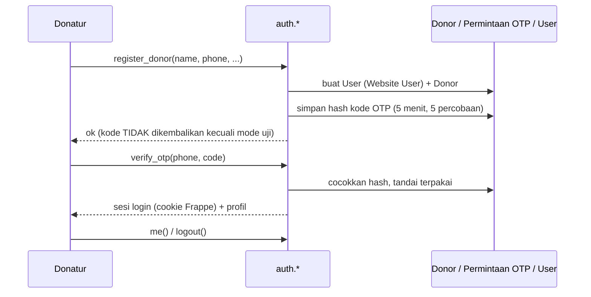
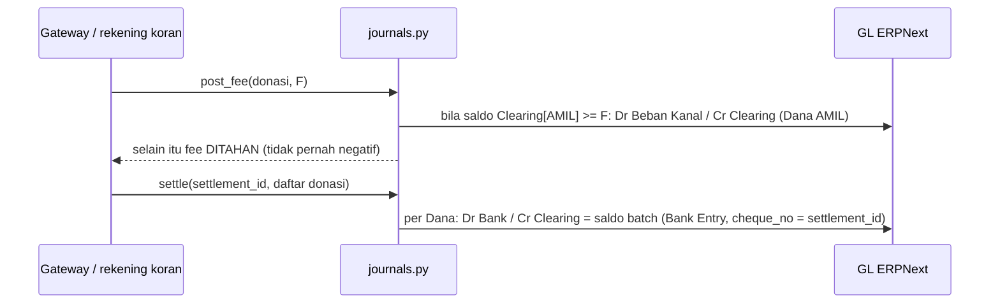
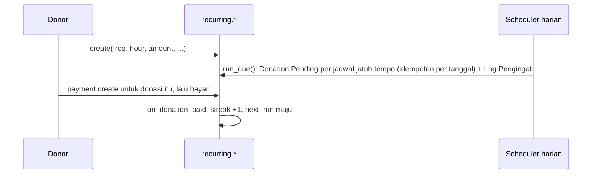
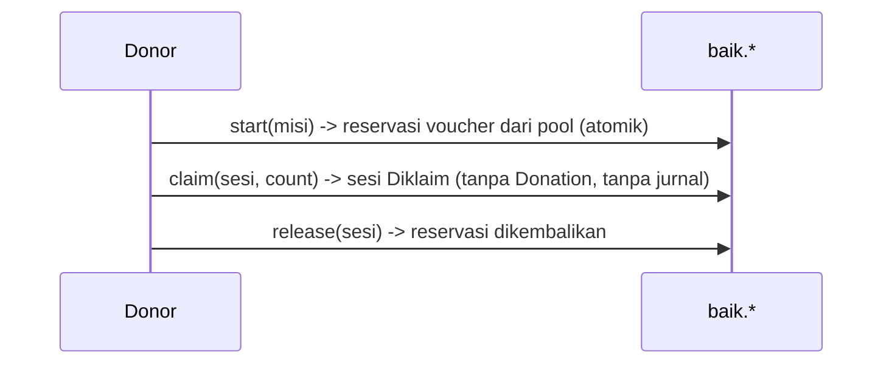

# 01. Alur Sistem (sequence)

Semua alur di bawah sudah terimplementasi dan teruji di `tests/test_w6_api.py` kecuali yang ditandai. Aktor: Donatur (D), UI, API (method whitelisted), DB/DocType, Gateway, ERPNext GL.

## 1. Daftar dan masuk (OTP) — FAKTA terimplementasi; pengiriman OTP nyata = belum


## 2. Donasi, pembayaran, lunas, jurnal — FAKTA (simulator); gateway nyata = USULAN
```mermaid
sequenceDiagram
  participant D as Donatur
  participant API as donation.* / payment.*
  participant GW as Gateway (simulator)
  participant DON as Donation
  participant J as journals.py (ERPNext GL)
  D->>API: donation.create(campaign, amount, ref, utm)
  API->>DON: Pending (id publik acak; min Rp3.000)
  API-->>D: donation_id
  D->>API: payment.create(donation_id, metode)
  API->>GW: charge (idempoten per donasi+metode)
  API-->>D: QR / nomor VA
  loop polling 5 dtk
    D->>API: donation.status(id)
  end
  GW->>API: payment.webhook(order_id, status, tanda tangan)
  API->>API: verifikasi SHA-512; tolak bila kunci tak ada/salah
  API->>DON: Pending -> Paid (maju saja, idempoten)
  DON->>J: bila posting_enabled & gerbang H.1 lulus: E2 penerimaan + E3 hak amil
  J-->>DON: je_receipt, je_amil (kunci donation_ref unik)
```

## 3. Fee dan settlement — FAKTA mesin jurnal; pemicu otomatis dari gateway = USULAN


## 4. Doa, Amin, lonceng — FAKTA
```mermaid
sequenceDiagram
  participant T as Tamu/Donor lain
  participant API as doa.* / notification.*
  participant O as Pemilik doa
  T->>API: doa.amin(doa, delta)  (maks 10 per pelaku per doa; batas laju)
  API->>API: tambah Doa Amin + Donation.amin_count
  O->>API: notification.list_notifications()
  API-->>O: {unread, items[{doa_id, aminers, total_aminers}]}
  O->>API: notification.mark_read()
```

## 5. Shadaqa Rutin — FAKTA


## 6. Jalan Kebaikan (misi) — FAKTA; akuntansi voucher DIBLOKIR (E18/F22)

