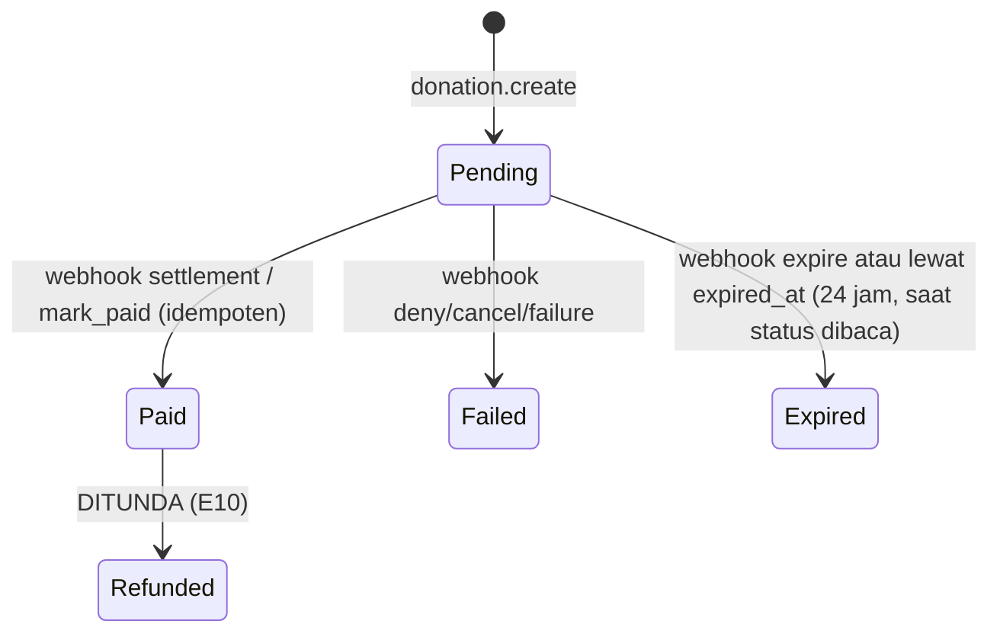

# 02. Alur Data dan Mesin Status

Status hanya boleh **maju**; transisi yang tidak tercantum ditolak atau diabaikan (idempoten). FAKTA = ada di kode; tes yang menjaganya disebut.

## Donation (`status`) — FAKTA

Penanda turunan pada Donation: `je_receipt` (E2), `je_amil` (E3), `fee_status` (Belum ada/Ditahan/Diposting, E4), `settled` + `settlement_id` (E5). Donation Paid yang gerbangnya tertutup tetap Paid tanpa jurnal; jurnal dapat diposting kemudian (idempoten) setelah `posting_enabled`.

## Permintaan Pembayaran — FAKTA
`pending -> paid | failed | expired`. `paid` final (webhook ulang = noop). Pembayaran baru untuk donasi yang bukan Pending ditolak. Permintaan identik (donasi+metode, pending) mengembalikan permintaan yang sama.

## Permintaan OTP — FAKTA
`dibuat -> terpakai` atau `kedaluwarsa` (5 menit) atau `terkunci` (5 percobaan salah; kode benar pun ditolak sesudahnya).

## Sesi Kebaikan — FAKTA
`Aktif -> Diklaim | Dilepas | Kedaluwarsa`. Reservasi pool dikurangi saat start; dikembalikan saat Dilepas/Kedaluwarsa; tak dikembalikan saat Diklaim.

## Jadwal Rutin — FAKTA
`Aktif <-> Dijeda`, `Aktif|Dijeda -> Dibatalkan` (final). Eksekusi per tanggal: `Dibuat -> Dibayar`.

## Klaim Hadiah — USULAN (status `Diajukan -> Dikirim -> Selesai | Dibatalkan` diubah petugas di Desk; belum ada UI/aturan transisi di kode)

## Aliran data utama
1. Konten (kampanye, penyaluran, artikel, mitra, metode bayar...) -> impor snapshot (`setup/import_snapshot.py`) atau Desk -> method baca publik.
2. Transaksi: UI -> `donation.create` -> Donation -> `payment.create` -> Permintaan Pembayaran -> webhook -> Donation Paid -> (gerbang) -> Journal Entry per Dana -> laporan ERPNext.
3. Agregat (Donor.total_*, Mitra.total_raised, Donation.amin_count, raised kampanye) dihitung ulang dari Donation Paid / Doa Amin, bukan disimpan sebagai sumber kebenaran.
