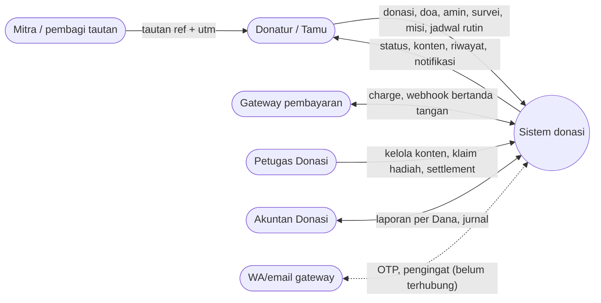
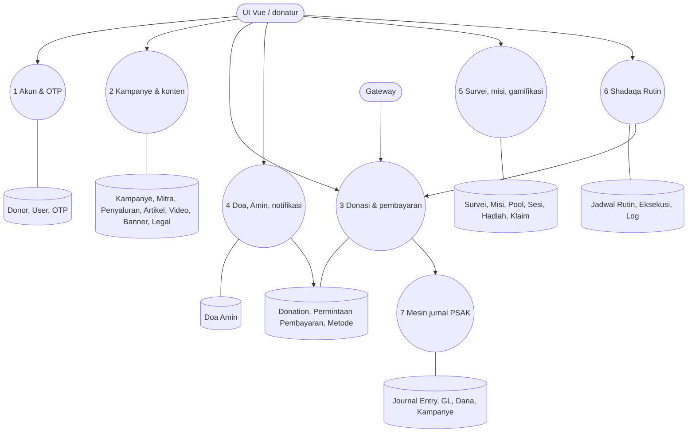
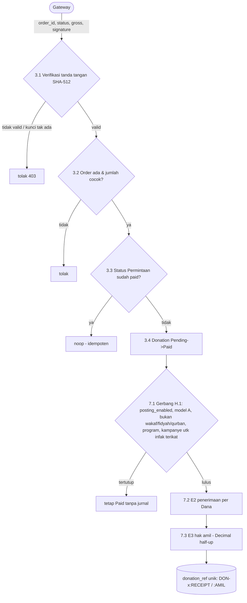
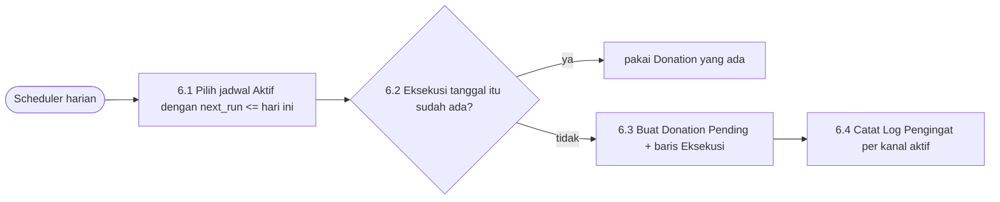

# 03. Diagram Alur Data (DFD)

Notasi: persegi = entitas luar, lingkaran/bulat = proses, silinder = penyimpanan. Status: USULAN struktur; setiap proses sudah memiliki padanan kode (lihat 05).

## Level 0

## Level 1

## Level 2 — proses kritis: webhook sampai jurnal (proses 3 + 7)

## Level 2 — proses Shadaqa Rutin harian (proses 6)

