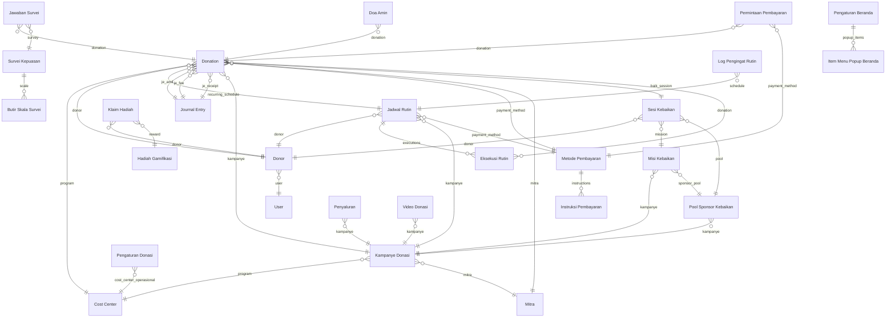

# 04. ERD dan DocType (HASIL OTOMATIS)

Dihasilkan oleh `tools/gen_sistem_docs.py` dari `tools/spec_doctypes.py` (sumber tunggal) — jangan sunting tangan. Status: **FAKTA** (DocType benar-benar ada dan termigrasi di site uji dan site utama). Nama field dan relasi adalah **USULAN** yang sudah dibangun.

## Daftar DocType

| DocType | Jenis | Jumlah field | Relasi keluar (Link/Table) |
|---|---|---|---|
| Mitra | master/transaksi | 8 | - |
| Banner | master/transaksi | 5 | - |
| Wilayah | master/transaksi | 2 | - |
| Halaman Legal | master/transaksi | 6 | - |
| Ayat Quran Jar | master/transaksi | 2 | - |
| Penyaluran | master/transaksi | 10 | Kampanye Donasi |
| Artikel | master/transaksi | 9 | - |
| Video Donasi | master/transaksi | 8 | Kampanye Donasi |
| Laporan Donasi | master/transaksi | 3 | - |
| Harga Emas | single | 5 | - |
| Item Menu Popup Beranda | child | 3 | - |
| Pengaturan Beranda | single | 3 | Item Menu Popup Beranda |
| Instruksi Pembayaran | child | 2 | - |
| Metode Pembayaran | master/transaksi | 11 | Instruksi Pembayaran |
| Permintaan Pembayaran | master/transaksi | 15 | Donation, Metode Pembayaran |
| Donor | master/transaksi | 14 | User |
| Permintaan OTP | master/transaksi | 6 | - |
| Doa Amin | master/transaksi | 5 | Donation |
| Butir Skala Survei | child | 2 | - |
| Survei Kepuasan | master/transaksi | 8 | Butir Skala Survei |
| Jawaban Survei | master/transaksi | 4 | Donation, Survei Kepuasan |
| Eksekusi Rutin | child | 4 | Donation |
| Jadwal Rutin | master/transaksi | 16 | Donor, Eksekusi Rutin, Kampanye Donasi, Metode Pembayaran |
| Log Pengingat Rutin | master/transaksi | 4 | Jadwal Rutin |
| Pool Sponsor Kebaikan | master/transaksi | 7 | Kampanye Donasi |
| Misi Kebaikan | master/transaksi | 19 | Kampanye Donasi, Pool Sponsor Kebaikan |
| Sesi Kebaikan | master/transaksi | 7 | Donor, Misi Kebaikan, Pool Sponsor Kebaikan |
| Level Gamifikasi | master/transaksi | 3 | - |
| Hadiah Gamifikasi | master/transaksi | 6 | - |
| Klaim Hadiah | master/transaksi | 7 | Donor, Hadiah Gamifikasi |
| Pengaturan Gamifikasi | single | 3 | - |
| Kampanye Donasi | master (keuangan, W3/W4; diperluas W6) | 23 | Cost Center, Mitra |
| Donation | transaksi (keuangan, W3/W4; diperluas W6) | 45 | Cost Center, Donor, Jadwal Rutin, Journal Entry, Kampanye Donasi, Metode Pembayaran, Mitra, Sesi Kebaikan |
| Dana | master (keuangan, W3) | 5 | - |
| Pengaturan Donasi | single (keuangan, W3/W4; diperluas W6) | 6 | Company, Cost Center |

## ERD (Mermaid)

Catatan: Journal Entry, Cost Center, dan User adalah DocType ERPNext/Frappe. `Donation.je_receipt/je_amil/je_fee` mengikat jurnal PSAK (W4). Dimensi akuntansi `Dana` dan `Kampanye` berada pada GL Entry, bukan relasi ERD.
